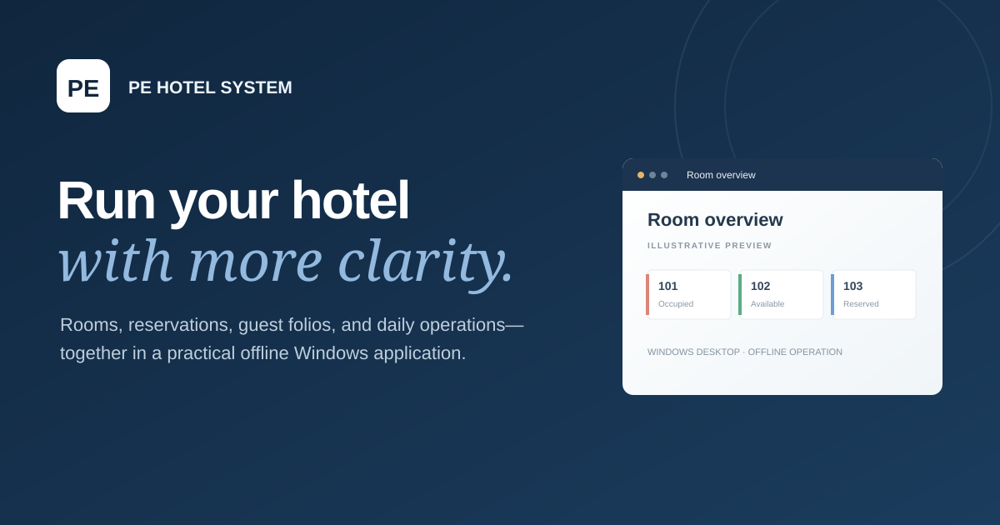

# PE Hotel Management System



> **Run your hotel with more clarity.**  
> Practical Windows desktop software for independent hotels—rooms, reservations, guest stays, payments, and reporting in one place.

[English](#english) · [ភាសាខ្មែរ](#ភាសាខ្មែរ)

## English

PE Hotel Management System helps independent hotels organize front-desk and day-to-day operations in a Windows desktop application. Hotel records are stored locally, so daily operations do not depend on a cloud-hosted hotel platform.

This product is **desktop software, not a web app**. Hotel operations and license validation work offline after activation.

### What you can manage

- **Rooms:** availability, reservations, cleanliness and maintenance status, and room history.
- **Reservations and front desk:** room assignments, arrivals and departures, check-in, check-out, cancellations, and no-shows.
- **Guests:** guest profiles, in-house stays, arrivals, departures, and reservation lists.
- **Folios and payments:** guest charges, payments, discounts, balances, and invoices.
- **Reports:** occupancy, reservations, guest statistics, revenue, and financial activity.
- **Night audit:** daily activity, room charges, and business-day closing or reopening.
- **City ledger:** company account transfers, payments, balances, and activity reports.
- **Staff and setup:** rooms, rates, payment methods, staff accounts, roles, and permissions.

Housekeeping-related functionality currently includes room-condition tracking and lost-and-found records.

### License options

| Plan | Listed price |
| --- | ---: |
| Monthly | $5 / month |
| Yearly | $50 / year |
| Lifetime | $240 one time |

Monthly and yearly prices are software-license subscriptions, not cloud-hosting fees. Contact the developer to confirm activation, device coverage, renewals, updates, and support before purchasing. This website does not provide online checkout.

### Getting started

1. Choose a license option.
2. Contact the developer to discuss your hotel and confirm the current license terms.
3. Receive the activation key and setup instructions.
4. Install the application on Windows and manage daily operations offline.

### Contact

- [Telegram — @Pe_av](https://t.me/Pe_av)
- [Email — seavpeavpech24@gmail.com](mailto:seavpeavpech24@gmail.com)
- [Facebook](https://www.facebook.com/share/1FXidiHzsh/)
- [WhatsApp](https://wa.me/85516700896)
- [Portfolio](https://seavpeavpech24-bot.github.io/)
- [GitHub](https://github.com/seavpeavpech24-bot)

The website's Telegram, WhatsApp, and email buttons prepare an inquiry message in the visitor's selected language. The message can be edited before sending.

### About this website

This repository contains the PE Hotel Management System product website. It includes:

- English and Khmer language controls.
- Light and dark themes, with preferences saved in the visitor's browser.
- A responsive layout for mobile and desktop screens.
- An interactive illustrative preview for Rooms, Guests, Reports, and Tools. Its sample data is not connected to the desktop application or a live hotel database, and it is not a product screenshot.
- Contact links with localized inquiry templates and a floating Telegram button.

The website is static HTML, CSS, and vanilla JavaScript. It has no backend or runtime package dependencies.

### Run the website locally

Open `index.html` in a browser, or serve this folder with a static file server. The site uses relative asset paths.

### Publish with GitHub Pages

The included GitHub Actions workflow deploys the website when changes are pushed to the `main` branch. To publish:

1. Create an empty GitHub repository for the website. Do not initialize it with a README, license, or `.gitignore`.
2. In the repository, open **Settings → Pages** and set **Build and deployment → Source** to **GitHub Actions**.
3. Open a terminal in this `PE-Hotel-Website` folder and run the following commands. Replace the remote URL with your repository's URL:

   ```powershell
   git init -b main
   git add .
   git commit -m "Prepare PE Hotel website for GitHub Pages"
   git remote add origin https://github.com/YOUR_USERNAME/YOUR_REPOSITORY.git
   git push -u origin main
   ```

4. In the repository's **Actions** tab, wait for **Deploy website to GitHub Pages** to finish.
5. Open the published URL shown under **Settings → Pages**. Later pushes to `main` deploy automatically; you can also start a deployment from the Actions tab.

The workflow publishes only the website files (`index.html`, `.nojekyll`, `assets/`, `css/`, and `js/`), not this README or the workflow itself.

## ភាសាខ្មែរ

ប្រព័ន្ធគ្រប់គ្រងសណ្ឋាគារ PE ជួយសណ្ឋាគារឯករាជ្យរៀបចំការងារទទួលភ្ញៀវ និងប្រតិបត្តិការប្រចាំថ្ងៃ តាមរយៈកម្មវិធីកុំព្យូទ័រ Windows។ ទិន្នន័យសណ្ឋាគារត្រូវបានរក្សាទុកក្នុងកុំព្យូទ័រផ្ទាល់ ដូច្នេះការងារប្រចាំថ្ងៃមិនពឹងផ្អែកលើប្រព័ន្ធ Cloud ទេ។

នេះជា **កម្មវិធីកុំព្យូទ័រ មិនមែនជាកម្មវិធីគ្រប់គ្រងសណ្ឋាគារតាមគេហទំព័រទេ**។ បន្ទាប់ពីធ្វើឱ្យអាជ្ញាបណ្ណសកម្ម អ្នកអាចប្រើមុខងារប្រតិបត្តិការ និងផ្ទៀងផ្ទាត់អាជ្ញាបណ្ណក្រៅបណ្ដាញបាន។

### មុខងារដែលអាចគ្រប់គ្រងបាន

- **បន្ទប់៖** ភាពទំនេរ ការកក់ ស្ថានភាពសម្អាត និងជួសជុល ព្រមទាំងប្រវត្តិបន្ទប់។
- **ការកក់ និងផ្នែកទទួលភ្ញៀវ៖** ការកំណត់បន្ទប់ ភ្ញៀវមកដល់ និងចាកចេញ ការចូលស្នាក់នៅ ការចាកចេញ ការលុបការកក់ និងករណីមិនបានមកដល់។
- **ភ្ញៀវ៖** ព័ត៌មានភ្ញៀវ បញ្ជីភ្ញៀវកំពុងស្នាក់នៅ ភ្ញៀវមកដល់ ចាកចេញ និងការកក់។
- **បញ្ជីចំណាយ និងការទូទាត់៖** ចំណាយភ្ញៀវ ការទូទាត់ ការបញ្ចុះតម្លៃ សមតុល្យ និងវិក្កយបត្រ។
- **របាយការណ៍៖** អត្រាកាន់កាប់បន្ទប់ ការកក់ ស្ថិតិភ្ញៀវ ចំណូល និងសកម្មភាពហិរញ្ញវត្ថុ។
- **ការបិទបញ្ជីប្រចាំថ្ងៃ៖** សកម្មភាពប្រចាំថ្ងៃ ការគិតថ្លៃបន្ទប់ និងការបិទ ឬបើកថ្ងៃប្រតិបត្តិការឡើងវិញ។
- **គណនី City Ledger៖** ការផ្ទេរគណនីក្រុមហ៊ុន ការទូទាត់ សមតុល្យ និងរបាយការណ៍សកម្មភាពគណនី។
- **បុគ្គលិក និងការកំណត់ប្រព័ន្ធ៖** បន្ទប់ តម្លៃ វិធីទូទាត់ គណនីបុគ្គលិក តួនាទី និងសិទ្ធិប្រើប្រាស់។

មុខងារពាក់ព័ន្ធនឹងការងារសម្អាតបច្ចុប្បន្នមានការតាមដានស្ថានភាពបន្ទប់ និងកំណត់ត្រារបស់របរបាត់ និងរកឃើញ។

### ជម្រើសអាជ្ញាបណ្ណ

| គម្រោង | តម្លៃដែលបានបង្ហាញ |
| --- | ---: |
| ប្រចាំខែ | $5 / ខែ |
| ប្រចាំឆ្នាំ | $50 / ឆ្នាំ |
| ពេញមួយជីវិត | $240 បង់តែមួយលើក |

តម្លៃប្រចាំខែ និងប្រចាំឆ្នាំគឺជាថ្លៃអាជ្ញាបណ្ណកម្មវិធី មិនមែនថ្លៃបង្ហោះលើ Cloud ទេ។ មុនពេលទិញ សូមទាក់ទងអ្នកបង្កើត ដើម្បីបញ្ជាក់ការធ្វើឱ្យអាជ្ញាបណ្ណសកម្ម ចំនួនឧបករណ៍ ការបន្ត ការអាប់ដេត និងជំនួយ។ គេហទំព័រនេះមិនមានប្រព័ន្ធទូទាត់ប្រាក់តាមអនឡាញទេ។

### របៀបចាប់ផ្ដើម

1. ជ្រើសរើសជម្រើសអាជ្ញាបណ្ណ។
2. ទាក់ទងអ្នកបង្កើត ដើម្បីពិភាក្សាអំពីសណ្ឋាគាររបស់អ្នក និងបញ្ជាក់លក្ខខណ្ឌអាជ្ញាបណ្ណបច្ចុប្បន្ន។
3. ទទួលលេខកូដធ្វើឱ្យសកម្ម និងការណែនាំដំឡើង។
4. ដំឡើងកម្មវិធីលើ Windows ហើយគ្រប់គ្រងការងារប្រចាំថ្ងៃក្រៅបណ្ដាញ។

### អំពីគេហទំព័រនេះ

ឃ្លាំងកូដនេះមានគេហទំព័របង្ហាញផលិតផល PE Hotel Management System។ គេហទំព័រមានភាសាអង់គ្លេស និងខ្មែរ របៀបភ្លឺ និងងងឹត ប្លង់សម្របតាមទូរស័ព្ទ និងកុំព្យូទ័រ និងផ្ទាំងសាកល្បងអន្តរកម្មសម្រាប់បន្ទប់ ភ្ញៀវ របាយការណ៍ និងឧបករណ៍។

ទិន្នន័យក្នុងផ្ទាំងសាកល្បងគឺជាទិន្នន័យគំរូប៉ុណ្ណោះ មិនបានភ្ជាប់ទៅកម្មវិធីកុំព្យូទ័រ ឬទិន្នន័យសណ្ឋាគារផ្ទាល់ទេ ហើយក៏មិនមែនជារូបថតអេក្រង់ផលិតផលពិតដែរ។ គេហទំព័រនេះប្រើ HTML, CSS និង JavaScript ហើយមិនមាន backend ឬតម្រូវការកញ្ចប់កម្មវិធីសម្រាប់ដំណើរការទេ។

### ទំនាក់ទំនង

- [Telegram — @Pe_av](https://t.me/Pe_av)
- [អ៊ីមែល — seavpeavpech24@gmail.com](mailto:seavpeavpech24@gmail.com)
- [Facebook](https://www.facebook.com/share/1FXidiHzsh/)
- [WhatsApp](https://wa.me/85516700896)
- [Portfolio](https://seavpeavpech24-bot.github.io/)
- [GitHub](https://github.com/seavpeavpech24-bot)

ប៊ូតុង Telegram, WhatsApp និងអ៊ីមែលនៅលើគេហទំព័រនឹងរៀបចំសារសាកសួរតាមភាសាដែលអ្នកបានជ្រើសរើស។ អ្នកអាចកែសម្រួលសារមុនពេលផ្ញើ។

### ដំណើរការ និងបង្ហោះគេហទំព័រ

បើក `index.html` ដោយប្រើកម្មវិធីរុករកគេហទំព័រ ឬប្រើ static file server។ ដើម្បីបង្ហោះលើ GitHub Pages សូមអនុវត្តតាមផ្នែក [Publish with GitHub Pages](#publish-with-github-pages) ខាងលើ។
